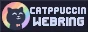

<h3 align="center">
  
</h3>

  
  
  
  
	

This website is built with [Quartz v5](https://github.com/jackyzha0/quartz), using [Catppuccin](https://github.com/catppuccin/catppuccin) Latte/Mocha as it's color palette. _Frenchified Ame-chan (site mascot) in banner_ commissioned from [coredeter](https://coredeter.carrd.co/).

## How to get started with Quartz
https://quartz.jzhao.xyz/

	Copyright &copy; 2023-2026 <a href="https://github.com/JoubaMety" target="_blank">Jan "JoubaMety" Rašnovský</a>

	

